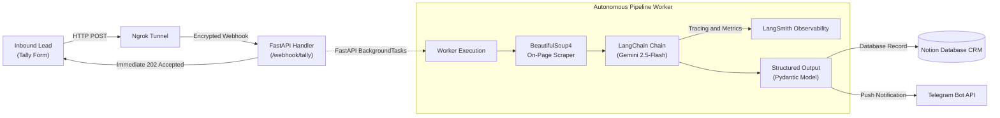

# Autonomous AI SEO Audit & Lead Enrichment Pipeline

An enterprise-grade, asynchronous AI engineering pipeline that captures inbound B2B prospects, executes on-page technical SEO scraping, analyzes content gaps using Gemini 2.5-Flash with structured outputs, writes records into a Notion CRM, and delivers instant sales alerts via Telegram.

---

## 🏗️ Architecture Overview

The system utilizes an event-driven architecture designed to eliminate webhook timeouts by decoupling ingestion from compute-intensive LLM workflows:



---

## ⚡ Key Engineering Features

* **Non-Blocking Ingestion**: Webhooks return an immediate `202 Accepted` response in `<200 ms` via FastAPI `BackgroundTasks`, preventing client timeouts during 7-second scraping and inference routines.
* **Deterministic Structured Output**: Employs LangChain Pydantic output parsers with `gemini-2.5-flash` to enforce strict data contracts for scores, technical issues, content recommendations, and outreach copy.
* **Full Observability & Tracing**: Fully instrumented with **LangSmith** to monitor LLM token costs, call latency ($P50/P99$), zero-failure rates, and prompt performance.
* **Automated Lead Enrichment**: Automatically extracts HTML metadata, headings (`H1`, `H2`), and paragraph samples, transforming raw DOM structures into structured CRM properties in Notion.
* **Omnichannel SDR Alerting**: Sends instant outbound alerts to Telegram including lead metadata, calculated SEO health scores, and cold outreach email drafts.

---

## 🛠️ Tech Stack

* **Backend & API Framework:** FastAPI, Uvicorn, Pydantic v2
* **LLM Orchestration:** LangChain, Google Gemini 2.5-Flash
* **Observability & Monitoring:** LangSmith Tracing
* **Data Extraction:** BeautifulSoup4, Requests
* **External Integrations:** Notion Client SDK, Telegram Bot API, Tally Webhooks, Ngrok

---

## 🚀 Getting Started

### 1. Clone & Set Up Virtual Environment

```bash
git clone https://github.com/FauzanV/ai-seo-automation-engine.git
cd ai-seo-automation-engine
python -m venv venv
```

Activate environment:
* **Windows (PowerShell):** `venv\Scripts\activate`
* **macOS / Linux:** `source venv/bin/activate`

Install dependencies:
```bash
pip install -r requirements.txt
```

### 2. Environment Configuration

Copy `.env.example` to `.env` and fill in your keys:

```bash
cp .env.example .env
```

| Environment Variable | Description |
| :--- | :--- |
| `GOOGLE_API_KEY` | Google Gemini API Key |
| `LANGCHAIN_API_KEY` | LangSmith API Key for observability |
| `LANGCHAIN_PROJECT` | Target project name in LangSmith |
| `NOTION_API_KEY` | Notion Integration Secret Token |
| `NOTION_DATABASE_ID` | Target Notion Database ID |
| `TELEGRAM_BOT_TOKEN` | Bot API Token generated via `@BotFather` |
| `TELEGRAM_CHAT_ID` | Telegram User ID for push notifications |

### 3. Run Locally

Start the Uvicorn application server:
```bash
uvicorn main:app --reload --port 8000
```

Expose local server to public webhooks using Ngrok:
```bash
ngrok http 8000
```

Configure your Tally Webhook destination URL with:
```text
https://<your-ngrok-url>.ngrok-free.dev/webhook/tally
```

---

## 📊 LangSmith Tracing Metric Demonstration

* **Model Used:** `models/gemini-2.5-flash`
* **P50 Latency:** ~7.2s (Scraping + Structured Output Reasoning)
* **Error Rate:** 0.0%
* **Cost:** <$0.01 per end-to-end execution

---

## 📜 License
Distributed under the MIT License.